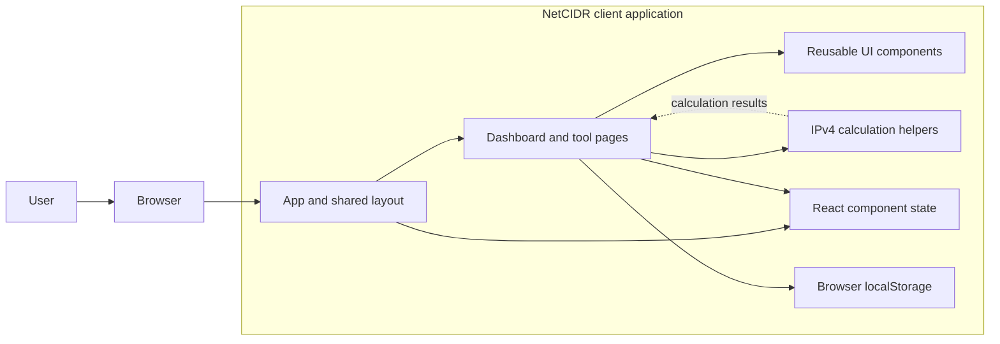
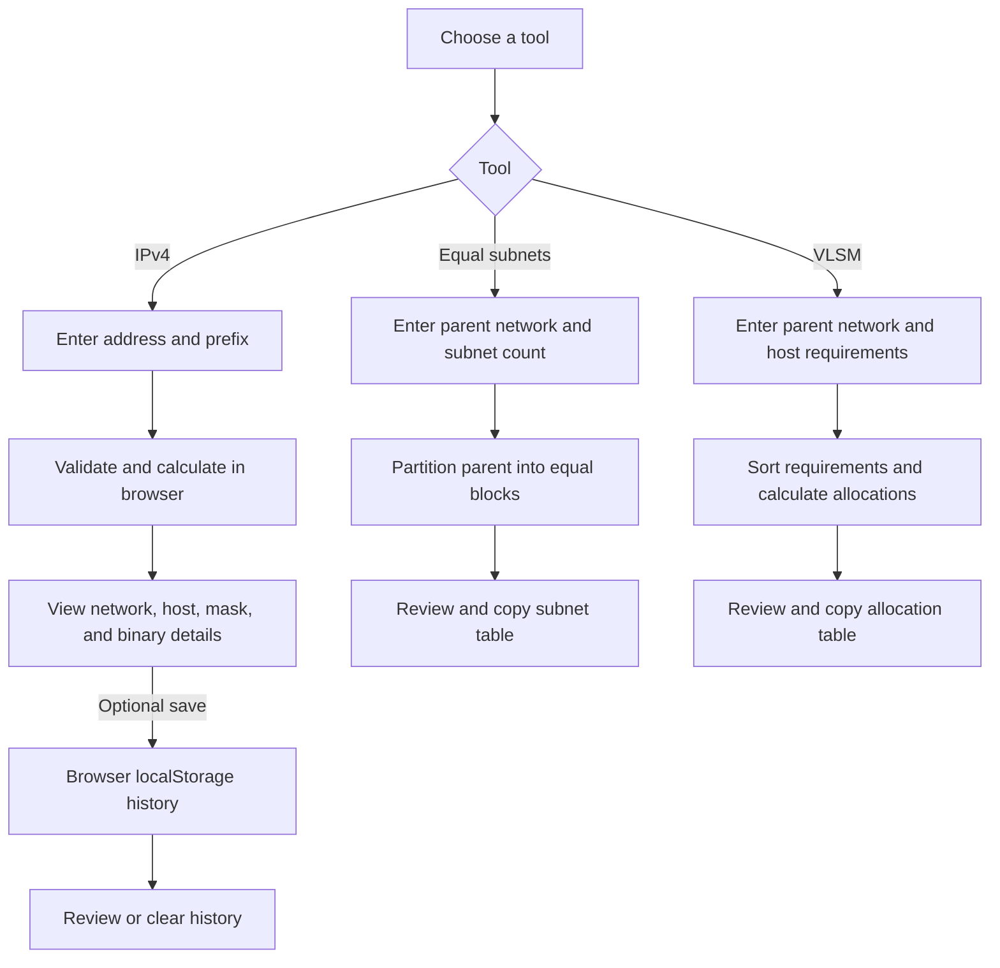

# IP Address & Subnet Calculator


**NetCIDR** is a browser-based IPv4 subnetting and network-planning tool. It provides IPv4 calculations, equal-size subnet generation, variable-length subnet mask (VLSM) planning, and a local history of saved calculations.

| Project detail | Status |
|---|---|
| Package version | `0.0.0` (from `package.json`) |
| Application | React 19 and TypeScript |
| Build and development server | Vite 8 |
| License | Not specified; this repository does not include a `LICENSE` file |
| Automated build status | No CI workflow is configured |

> The application is presented in the UI as **NetCIDR Subnet Utility Dashboard**. The package and repository are named `ipaddress-subnet-calculator`.

## Table of contents

- [Overview](#overview)
- [Problem, vision, and value](#problem-vision-and-value)
- [Features and users](#features-and-users)
- [Screenshots](#screenshots)
- [Architecture](#architecture)
- [Technology stack](#technology-stack)
- [Project structure](#project-structure)
- [Application internals](#application-internals)
- [Data, APIs, and security](#data-apis-and-security)
- [Development setup](#development-setup)
- [Build and deployment](#build-and-deployment)
- [Testing, linting, and debugging](#testing-linting-and-debugging)
- [Conventions and contribution](#conventions-and-contribution)
- [Limitations and roadmap](#limitations-and-roadmap)
- [FAQ and troubleshooting](#faq-and-troubleshooting)
- [Changelog, license, and credits](#changelog-license-and-credits)
- [Contact](#contact)

## Overview

The project is a single-page web application for calculating and studying IPv4 networks. It runs in the user's browser; calculation logic is in the frontend, and saved IPv4 calculations are kept in that browser's `localStorage`.

There is no application server, database, account system, or external calculation API. The app is suitable for quick reference and learning, and can be deployed as static files.

### Problem, vision, and value

Subnet planning involves translating between CIDR prefixes, masks, address ranges, and host capacity. Doing those calculations by hand can be slow and error-prone. NetCIDR brings common IPv4 calculations and visual explanations together in one interface.

The application's implemented objectives are to:

- Calculate IPv4 network details locally and show decimal and binary representations.
- Generate equal-sized subnet tables and propose VLSM allocations for host requirements.
- Provide educational material about subnetting and related IPv4 concepts.
- Let a user save, review, and remove a limited number of calculations in the current browser.

This can reduce repetitive manual calculations and provide learners and network practitioners with a convenient planning aid. It is not a network configuration tool: generated plans should be reviewed before implementation.

### Features and users

Implemented features:

- **IPv4 calculator:** accepts an IPv4 address and a `/0`–`/32` prefix; displays the network and broadcast addresses, subnet and wildcard masks, total addresses, usable-host count and range, address class and type, and binary breakdown.
- **Equal-subnet generator:** divides a normalized parent network into a power-of-two count of equal-size subnets and displays address ranges and capacity.
- **VLSM calculator:** accepts a parent network and department host requirements, sorts the requirements from largest to smallest, and displays sequential subnet allocations.
- **Calculation history:** explicitly saved IPv4 calculations can be reviewed, deleted individually, or cleared. The browser keeps up to 50 entries.
- **Learning and navigation:** a dashboard, in-app networking guide, responsive navigation, sample IPv4 scenarios, and CIDR quick selections.
- **Copy controls:** subnet CIDRs and table values can be copied through the browser clipboard API.

The interface is useful to networking students, educators, developers, and network or infrastructure practitioners who need a quick IPv4 reference. It has no separate administrator role or multi-user workflow.

Common use cases include:

- Checking the network and broadcast boundaries for an IPv4 address and CIDR prefix.
- Comparing subnet sizes and address ranges while dividing a parent network into equal blocks.
- Sketching a department-by-department VLSM plan from host-count requirements.
- Reviewing subnetting concepts or revisiting an IPv4 result saved in the current browser.

The practical value is faster, repeatable reference calculations and a visual way to study subnetting. Because allocations are not comprehensively validated against parent-network capacity, the tool should support—not replace—independent network-plan review.

### Screenshots

No application screenshots are currently maintained in the repository. `src/assets/hero.png` is a decorative image, not a screenshot of the running application.

## Architecture

### High-level architecture

The application is a client-side React SPA. The app shell holds the active view, page components render forms and results, calculation helpers perform IPv4 arithmetic, and the history helpers access browser storage.



There is no backend tier or database in the current implementation. The dotted relationship in the diagram represents calculated values flowing back to the UI; calculation helpers do not write history themselves.

### Application workflow

1. The user chooses an in-app view using the sidebar or dashboard. The selected view is held in React state; it is not represented by a URL route.
2. A calculator validates its input and computes results in the browser using helpers from `src/utils/ipUtils.ts` or page-level subnet allocation logic.
3. The page renders the results and, where available, offers copy controls.
4. In the IPv4 calculator, the user may explicitly save a result. The history helper stores it in browser `localStorage`.
5. The History view loads saved entries from the same browser origin and lets the user inspect or remove them.



## Technology stack

| Area | Technology | Role |
|---|---|---|
| User interface | React 19, React DOM | Component-based single-page interface |
| Language | TypeScript 6 | Application and shared model types |
| Development and build | Vite 8, React plugin | Local development server and static production build |
| Styling | Tailwind CSS 4, `@tailwindcss/vite` | Utility styling and CSS processing |
| Icons | `lucide-react` | Interface icons |
| Linting | Oxlint | JavaScript/TypeScript lint checks |
| Browser persistence | `localStorage` | Saved IPv4 calculation history |

## Project structure

```text
.
├── index.html
├── package.json
├── package-lock.json
├── vite.config.ts
├── tsconfig.json
├── tsconfig.app.json
├── tsconfig.node.json
├── .oxlintrc.json
├── public/
│   ├── favicon.svg
│   └── icons.svg
└── src/
    ├── App.tsx
    ├── main.tsx
    ├── App.css
    ├── index.css
    ├── assets/
    ├── components/
    │   ├── layout/
    │   ├── ui/
    │   └── Ipv4BreakdownTable.tsx
    ├── pages/
    ├── types/
    └── utils/
```

### Major folders and important files

| Path | Responsibility |
|---|---|
| `src/pages/Dashboard.tsx` | Entry view with navigation shortcuts and introductory networking concepts. |
| `src/pages/Ipv4Calculator.tsx` | Input validation, live IPv4 calculation, results, presets, and explicit save-to-history action. |
| `src/pages/SubnetCalculator.tsx` | Equal-size subnet generation from a parent IPv4 network and selected subnet count. |
| `src/pages/VlsmCalculator.tsx` | Department host-requirement editing and descending-size VLSM allocation display. |
| `src/pages/HistoryPage.tsx` | Loads, selects, reviews, deletes, and clears saved IPv4 calculations. |
| `src/pages/AboutPage.tsx` | Presents subnetting formulas and IPv4/CIDR RFC references. |
| `src/components/layout/Layout.tsx` | Composes the sidebar, header, page content, and footer. |
| `src/components/layout/Header.tsx` | Displays the active view title, status labels, mobile navigation, and theme control. |
| `src/components/layout/Sidebar.tsx` | Provides navigation among the six in-app views and the history count. |
| `src/components/ui/Card.tsx` | Shared card container with optional hover and glow styles. |
| `src/components/ui/Button.tsx` | Shared button variants, sizes, and optional icon support. |
| `src/components/ui/Badge.tsx` | Shared compact status and category label. |
| `src/components/Ipv4BreakdownTable.tsx` | Shared IPv4 decimal/binary results table with copy controls. |
| `src/utils/ipUtils.ts` | IPv4 validation, integer and binary conversions, masks, address classification, core calculation, and history storage helpers. |
| `src/types/index.ts` | Shared view, calculation result, subnet row, and VLSM types. |
| `src/assets/` | Source image and starter assets. The hero image is decorative; React and Vite SVGs are starter assets. |
| `public/` | Static files served from the site root; `favicon.svg` is referenced by the HTML entry point. |
| `src/App.tsx` | Active-view state, page selection, and history-count refresh. |
| `src/main.tsx` | React entry point; mounts the app in `index.html` under `StrictMode` and imports global CSS. |
| `src/index.css` | Tailwind import, dark base styling, and shared visual utilities. |
| `src/App.css` | Additional stylesheet currently not imported by the application entry point. |
| `index.html` | Vite HTML entry document, root element, page title, favicon, and script entry. |
| `package.json` / `package-lock.json` | Package metadata, scripts, dependencies, and reproducible npm dependency versions. |
| `vite.config.ts` | Enables the React and Tailwind CSS Vite plugins. |
| `tsconfig.json`, `tsconfig.app.json`, `tsconfig.node.json` | TypeScript project references and browser/application versus Vite configuration checks. |
| `.oxlintrc.json` | Oxlint plugins and rules. |

## Application internals

### Frontend architecture and state

`App.tsx` selects a page using the `ActiveView` union from `src/types/index.ts`; navigation is client-side React state rather than a routing library. `Layout.tsx` composes the responsive sidebar and header around the active page. The page components own their form, error, and result state with React state hooks.

The IPv4 and equal-subnet calculations update as their inputs change. The VLSM view recomputes allocations when its base network or department list changes. There is no shared state-management library. The theme control is present in the header, but currently only changes its icon/state; the application remains styled as a dark interface.

### Backend, database, APIs, and authentication

| Concern | Current implementation |
|---|---|
| Backend | None; the application runs in the browser. |
| Database | None. |
| HTTP API | None. Calculations are local function calls, not network requests. |
| Authentication and authorization | None; there are no accounts, roles, or protected operations. |
| AI or automation services | None. |
| Third-party runtime services | None. The UI uses locally installed React, Tailwind CSS, and Lucide packages. |

### Data and storage

- Form values and calculation results remain in React component state unless explicitly saved.
- Only IPv4 calculator results are stored in history. Equal-subnet and VLSM results are not persisted.
- History is stored under the `ip_subnet_calc_history` key in the browser's `localStorage`, scoped to the site origin and browser profile.
- Saving removes existing entries with the same IP and prefix, puts the new result first, and keeps at most 50 entries.
- Clearing browser data, using another browser/profile, or changing the site's origin will make the saved history unavailable.

## Development setup

### Prerequisites

- Node.js **20.19+** or **22.12+**, as required by the installed Vite version.
- npm (included with Node.js).
- A modern browser with JavaScript enabled.

No API keys, server process, database, or `.env` file are needed.

### Installation

From the repository root:

```bash
npm ci
```

`npm ci` installs the versions recorded in `package-lock.json`.

### Run in development

```bash
npm run dev
```

Open the local URL printed by Vite, normally `http://localhost:5173`. Vite provides hot module replacement during development.

### Environment variables and configuration

There are no application environment variables or `.env` files required or read by the current implementation. The key project configuration is:

- `vite.config.ts`: React and Tailwind CSS plugins.
- `tsconfig*.json`: TypeScript targets, module resolution, and project references.
- `.oxlintrc.json`: lint plugins and rules.
- `package.json`: scripts, dependencies, and package version.
- `index.html`: document title, favicon, and client entry point.

The Vite configuration does not set a deployment `base` path. Deploying under a nested URL prefix may therefore require configuring `base` in `vite.config.ts` and rebuilding.

## Build and deployment

### Production build and preview

Create the optimized static site:

```bash
npm run build
```

This runs the TypeScript project build (`tsc -b`) and then Vite's production build. The generated site is written to `dist/`.

To serve the build locally for a smoke check:

```bash
npm run preview
```

The preview server is for local verification; it is not a production hosting service.

### Deployment

Deploy the contents of `dist/` to any static web host that can serve HTML, CSS, JavaScript, and static assets over HTTPS. A typical deployment pipeline is:

1. Install dependencies with `npm ci`.
2. Run `npm run build`.
3. Publish `dist/` as the site's static root.
4. Open the deployed site and verify navigation, calculations, clipboard actions, and local history.

No deployment provider, domain, hosting workflow, or server-side rewrite configuration is included in this repository. The current app uses in-page state instead of URL routes, so route fallback rules are not needed for its existing views. For a nested deployment path, configure Vite's `base` before building.

### CI/CD and release process

No CI/CD configuration is present. Builds, lint checks, and deployment are manual unless a hosting provider adds its own integration. A release today can be made by reviewing changes, running the build and lint commands, updating the package version if appropriate, building `dist/`, and publishing it through the chosen static host.

## Testing, linting, and debugging

### Testing strategy

There are currently no unit, integration, or end-to-end test files and no test script in `package.json`. Calculation helpers in `src/utils/ipUtils.ts` and the VLSM/equal-subnet allocation flows are good candidates for unit tests; user-facing calculation and history flows are candidates for browser tests.

### Linting and build checks

```bash
npm run lint
npm run build
```

The build performs TypeScript checks before bundling. Oxlint currently completes with warnings about effect dependencies/state updates in `App.tsx` and several calculator/history pages; these warnings are not configured as build blockers.

### Debugging tips

- Use the browser developer tools to inspect JavaScript errors and network requests; the app does not call an application API.
- To inspect local history, open the browser's Application/Storage tools and look for `localStorage` key `ip_subnet_calc_history`.
- To remove only this app's saved history, delete that key for the current site origin, or use the History view's clear action.
- If clipboard buttons do not work, use a secure context (normally HTTPS or localhost) and allow clipboard access in the browser.
- If Vite cannot start, confirm the Node.js version meets the prerequisite and dependencies are installed.

### Logging and monitoring

No application logging, telemetry, error reporting, or monitoring service is configured. The calculation workflow runs in the browser; storage helper failures are reported to the browser console.

## Security considerations and performance

- Calculations are performed locally and no user-entered address is sent to a project backend because none exists.
- Saved history is browser-local data, not encrypted or synchronized. Avoid relying on `localStorage` for secrets or sensitive records.
- There is no authentication, access control, server-side validation, or server-side storage.
- Use HTTPS when hosting the production build, especially for browser clipboard support.
- The app uses synchronous 32-bit integer operations and small in-memory result sets for its current calculations. It has no remote data fetching or separate performance-monitoring setup.
- The VLSM planner currently does not verify that all requested allocations fit within the supplied parent network. Treat its output as a planning aid and independently validate allocations before configuring real networks.

## Conventions and contribution

### Coding standards

- Use TypeScript and the existing shared types in `src/types/index.ts` for cross-component data.
- Keep view-specific UI in `src/pages/`, shared layout in `src/components/layout/`, and reusable controls in `src/components/ui/`.
- Keep shared IPv4 helpers in `src/utils/ipUtils.ts` rather than duplicating common conversions.
- Follow existing React component and Tailwind CSS conventions.
- Run `npm run lint` and `npm run build` before proposing changes.

### Contributing guidelines

There is no `CONTRIBUTING.md` or formal branch policy yet. A practical contribution workflow is:

1. Open an issue or discussion to describe substantial changes before implementation.
2. Create a focused feature or fix branch from the repository's default branch.
3. Keep changes scoped, and add tests when introducing or changing calculation behavior.
4. Run the lint and build checks.
5. Open a pull request with the problem, solution, and verification steps.

Please do not describe an unimplemented feature as available. Add or update documentation when a user-visible behavior, setup step, or project convention changes.

### Versioning and branching

The package currently declares version `0.0.0`; no release/versioning policy is configured. The repository does not document a required branching or commit-message convention. Semantic versioning and short-lived feature branches are reasonable options if the maintainers adopt a formal release process.

## Limitations and roadmap

### Known limitations

- IPv6 is not supported.
- The app has no server, user accounts, database, cross-device history, or HTTP API.
- Only saved IPv4 calculations appear in history; subnet-generator and VLSM plans are not saved.
- The equal-subnet tool produces equal, power-of-two subnet counts from its available selections.
- VLSM output is not checked against the parent network's capacity; verify that allocations fit before use.
- The theme control does not currently apply a light theme.
- No automated tests, CI/CD workflow, changelog, or license file is included.

### Future opportunities

The following are possible next steps, not committed or currently implemented roadmap items:

- Add unit tests for IPv4 conversion, mask, boundary, and address-range calculations.
- Add tests for equal-subnet and VLSM allocation, including parent-range overflow and alignment cases.
- Add accessibility and end-to-end checks for calculator, copy, and history flows.
- Establish CI to run build, lint, and tests on pull requests.
- Consider export/import or persistence for subnet and VLSM plans.
- Decide on a license, versioning policy, and contributor/release documentation.

## FAQ and troubleshooting

### Does the app send my calculations to a server?

No project backend or calculation API is configured. IPv4 history is saved in the browser's local storage for the current site origin.

### Why is my history empty on another device or browser?

History is stored in the current browser profile, not in an account or cloud database. It does not synchronize between devices or browser profiles.

### Why does history not contain my subnet-generator or VLSM output?

History saving is implemented for the IPv4 calculator only. The other tools display results in the current page but do not persist them.

### Why is the app showing an invalid IPv4 or prefix message?

Enter a dotted-decimal IPv4 address with four octets from `0` through `255` and a CIDR prefix from `/0` through `/32`. The input validator does not accept octets with leading zeros.

### Why does a copied value not reach the clipboard?

Clipboard access depends on browser support and permissions. Try localhost or an HTTPS deployment, then check the browser's clipboard permission for the site.

### Why will the site not start or build?

Check that Node.js is at least 20.19 or 22.12, run `npm ci`, and retry `npm run dev` or `npm run build`. Review the terminal output for TypeScript or dependency errors.

### Does the package version match the version shown in the app?

Not currently. `package.json` declares `0.0.0`, while the sidebar UI displays `v1.0`; there is no release process enforcing that these values stay aligned.

## Changelog, license, and credits

### Changelog

No `CHANGELOG.md` is currently maintained. When releases are introduced, record user-visible changes here or add a changelog using a consistent format such as Keep a Changelog.

### License

No license is specified in the repository. Until the maintainers add a `LICENSE` file, users should not assume that the project has been granted an open-source license.

### Credits and acknowledgements

The project is built with React, TypeScript, Vite, Tailwind CSS, Oxlint, and Lucide icons. Its educational guide references IPv4/CIDR concepts and mentions RFC 1918, RFC 3021, and RFC 4632.

## Contact

For project questions, bug reports, or contribution proposals, use the repository's GitHub issues and pull requests:
[bellagantilakshmiprasad225-a11y/IPaddress-Subnet-Calculator](https://github.com/bellagantilakshmiprasad225-a11y/IPaddress-Subnet-Calculator).

## Project summary

NetCIDR is a static, client-side IPv4 subnetting and learning application. Its current tools calculate IPv4 network details, generate equal-sized subnet tables, propose VLSM allocations, and store up to 50 explicitly saved IPv4 calculations in browser-local history. It requires Node.js and npm for development and builds to static files, with no backend, database, external API, authentication, test suite, or configured CI/CD.
